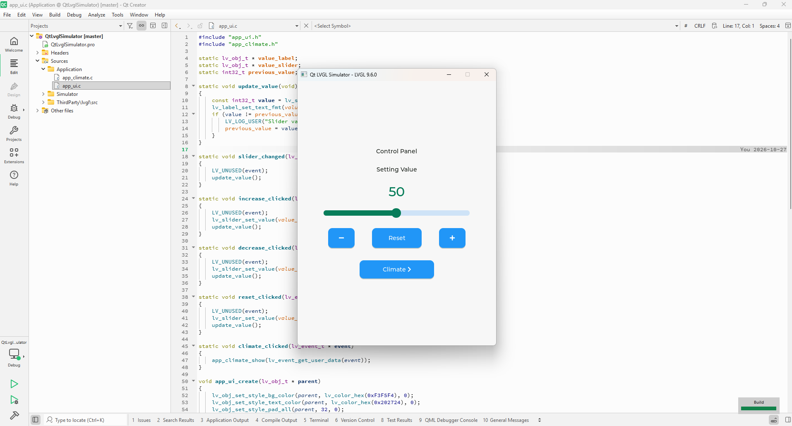
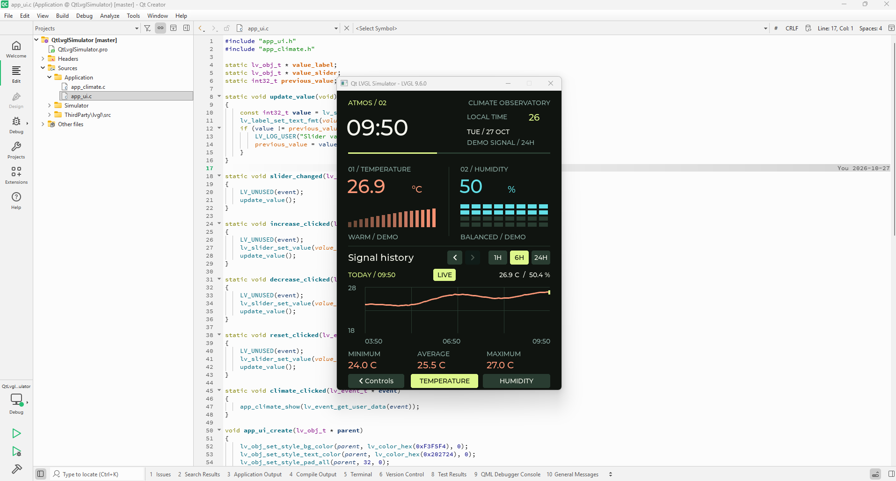

# Qt LVGL Simulator

[English](#english) | [Turkce](#turkce)

<a id="english"></a>
## English

LVGL simulator built with Qt Widgets. UI code is C; the Qt adapter handles the
window, mouse input and timing. The UI can be reused in an MCU project.





### Setup

```shell
git clone --recurse-submodules https://github.com/fozc/qt-lvgl-simulator.git
cd qt-lvgl-simulator
```

For a checkout without the LVGL submodule:

```shell
git submodule update --init --recursive
```

Open `QtLvglSimulator.pro` or `CMakeLists.txt` in Qt Creator, select a Desktop kit,
and build `lvgl_simulator`. Use separate build directories for qmake and CMake.

Tested on Windows with Qt 5.15.2 and MinGW 8.1, 64-bit. Qt 6 is supported by the
build files but has not been tested. Application code requires C99; the adapter
requires C++17. The CMake build requires CMake 3.21+ and Ninja. Tests also need QtTest.

### Build on Windows

Run from the repository root. Adjust the Qt paths to your installation.

```powershell
$env:Path = "C:\Qt\Tools\mingw810_64\bin;C:\Qt\5.15.2\mingw81_64\bin;" + $env:Path
```

qmake:

```powershell
qmake QtLvglSimulator.pro -o build-qmake/Makefile "CONFIG+=release" "CONFIG-=debug"
mingw32-make -C build-qmake -j8
./build-qmake/release/lvgl_simulator.exe
```

CMake:

```powershell
cmake -S . -B build -G Ninja -DCMAKE_BUILD_TYPE=Debug -DCMAKE_PREFIX_PATH=C:/Qt/5.15.2/mingw81_64 -DCMAKE_C_COMPILER=C:/Qt/Tools/mingw810_64/bin/gcc.exe -DCMAKE_CXX_COMPILER=C:/Qt/Tools/mingw810_64/bin/g++.exe
cmake --build build --parallel 8
./build/lvgl_simulator.exe
```

Qt Creator supplies runtime DLL paths. For a standalone executable, deploy the
matching Qt/compiler DLLs and the platform plugin. Use the kit's `windeployqt`.
If the tested kit reports `Unable to find the platform plugin`, copy
`Qt5Core.dll`, `Qt5Gui.dll`, `Qt5Widgets.dll` from the Qt `bin` directory,
`libgcc_s_seh-1.dll`, `libstdc++-6.dll`, `libwinpthread-1.dll` from the compiler
`bin` directory, and Qt's `plugins/platforms` directory beside the executable.

### Source Layout

| Path | Contents |
| --- | --- |
| `Application/` | LVGL screens, written in C |
| `Simulator/` | Qt display, mouse and timer adapter |
| `ThirdParty/lvgl/` | Official LVGL submodule, pinned to v9.6.0 |
| `Tests/` | QtTest rendering and interaction tests |
| `lv_conf.h` | LVGL configuration |

`Simulator/main.cpp` initializes LVGL, registers the display/input adapter and
calls `app_ui_create()`. A 5 ms Qt timer reports elapsed time to `lv_tick_inc()`
and runs `lv_timer_handler()`. All LVGL calls run on the GUI thread.

Add new sources to both `CMakeLists.txt` and `QtLvglSimulator.pro`.

### Demo

The 480 x 640 display has two pages. Controls contains a slider, increment,
decrement and reset buttons. Climate shows a clock, temperature bars, humidity
and a history plot.

Drag on the plot to select a sample. The 1H, 6H and 24H buttons change the time
window; the arrows move it by half its duration. LIVE returns to the latest
sample. TEMPERATURE and HUMIDITY switch the plot and its statistics.

Temperature and humidity are generated demo data, not sensor readings. History
covers 24 hours at five-minute intervals and is not saved to disk. The clock uses
system time, supplied through `app_climate_set_time(unix_seconds, utc_offset_minutes)`.

Logs appear in Qt Creator's Application Output panel. Use LVGL's logging API in
application code:

```c
LV_LOG_USER("Slider value: %d", (int)value);
```

### Tests

```powershell
cmake -S . -B build -DBUILD_TESTING=ON
cmake --build build --parallel 8
ctest --test-dir build --output-on-failure
```

Tests cover rendering, buttons, slider limits, chart selection, time windows,
midnight labels and page navigation. They run offscreen and save `simulator.png`
and `climate*.png` beside the test executable. Tests are available through CMake.

To check that Application builds without Qt, use the compiler paths from the
CMake example above and a separate directory:

```powershell
cmake -S . -B build-application -G Ninja -DBUILD_SIMULATOR=OFF -DCMAKE_C_COMPILER=C:/Qt/Tools/mingw810_64/bin/gcc.exe -DCMAKE_CXX_COMPILER=C:/Qt/Tools/mingw810_64/bin/g++.exe
cmake --build build-application --target application --parallel 8
```

### MCU Port

Add `Application/` and the same LVGL version to the board project. Supply display,
input and tick drivers, then call `app_ui_create(lv_screen_active())`. Feed the
clock from the board's RTC through `app_climate_set_time()` and replace the demo
generators with sensor data. Run all UI updates from the LVGL task.

`lv_conf.h` currently reserves a 256 KiB LVGL heap. Adjust it, the enabled fonts
and the display buffers for the board. `Simulator/` and `Tests/` are not needed
on the MCU. The Qt-free build is a dependency check, not an MCU cross-build.

### LVGL Updates

Choose a release tag, build both entry points and run the tests before recording
a new submodule revision:

```shell
git -C ThirdParty/lvgl fetch origin --tags
git -C ThirdParty/lvgl switch --detach v9.6.0
git add ThirdParty/lvgl
```

Replace `v9.6.0` with the chosen release and update the version in the docs.
Commit the gitlink with any required source changes. Other checkouts then run
`git submodule update --init --recursive`.

LVGL's license and pinned commit are listed in [ThirdParty/README.md](ThirdParty/README.md).

---

<a id="turkce"></a>
## Turkce

Qt Widgets uzerinde calisan LVGL simulatoru. Arayuz C ile yazilir; Qt katmani
pencereyi, fare girisini ve zamanlamayi yonetir. Arayuz kodu MCU'da kullanilabilir.

### Kurulum

```shell
git clone --recurse-submodules https://github.com/fozc/qt-lvgl-simulator.git
cd qt-lvgl-simulator
```

LVGL alt modulu eksikse:

```shell
git submodule update --init --recursive
```

Qt Creator'da `QtLvglSimulator.pro` veya `CMakeLists.txt` acin, Desktop kit secin
ve `lvgl_simulator` hedefini derleyin. qmake ve CMake icin ayri build klasorleri kullanin.

Windows'ta Qt 5.15.2 ve MinGW 8.1 64-bit ile test edildi. Derleme dosyalari Qt 6'yi
destekler; Qt 6 ile test edilmedi. Application icin C99, Qt katmani icin C++17
gerekir. CMake yolu CMake 3.21+ ve Ninja, testler de QtTest gerektirir.

### Windows'ta Derleme

Komutlari repo kokunde calistirin. Qt yollarini kendi kurulumunuza gore degistirin.

```powershell
$env:Path = "C:\Qt\Tools\mingw810_64\bin;C:\Qt\5.15.2\mingw81_64\bin;" + $env:Path
```

qmake:

```powershell
qmake QtLvglSimulator.pro -o build-qmake/Makefile "CONFIG+=release" "CONFIG-=debug"
mingw32-make -C build-qmake -j8
./build-qmake/release/lvgl_simulator.exe
```

CMake:

```powershell
cmake -S . -B build -G Ninja -DCMAKE_BUILD_TYPE=Debug -DCMAKE_PREFIX_PATH=C:/Qt/5.15.2/mingw81_64 -DCMAKE_C_COMPILER=C:/Qt/Tools/mingw810_64/bin/gcc.exe -DCMAKE_CXX_COMPILER=C:/Qt/Tools/mingw810_64/bin/g++.exe
cmake --build build --parallel 8
./build/lvgl_simulator.exe
```

Qt Creator DLL yollarini saglar. Programi disaridan calistirmak icin uyumlu Qt ve
derleyici DLL'lerini, ayrica platform eklentisini dagitin. `windeployqt` kullanin;
test edilen kitteki platform eklentisi hatasi icin gerekli dosyalar yukaridaki
Ingilizce bolumde listelenmistir.

### Kaynak Yapisi

| Yol | Icerik |
| --- | --- |
| `Application/` | C ile yazilan LVGL ekranlari |
| `Simulator/` | Qt ekran, fare ve zamanlayici katmani |
| `ThirdParty/lvgl/` | v9.6.0'a sabitlenmis resmi LVGL alt modulu |
| `Tests/` | QtTest cizim ve etkilesim testleri |
| `lv_conf.h` | LVGL ayarlari |

`Simulator/main.cpp`, LVGL ve ekran/giris suruculerini baslatip `app_ui_create()`
cagirir. 5 ms'lik Qt zamanlayicisi gecen sureyi `lv_tick_inc()` ile bildirir ve
`lv_timer_handler()` calistirir. Tum LVGL cagrilari ana is parcacigindadir.

Yeni kaynaklari hem `CMakeLists.txt` hem `QtLvglSimulator.pro` listesine ekleyin.

### Demo

480 x 640 ekranda iki sayfa bulunur. Controls sayfasinda slider, artirma,
azaltma ve sifirlama dugmeleri vardir. Climate sayfasinda saat, sicaklik
cubuklari, nem ve gecmis grafigi bulunur.

Ornek secmek icin grafikte surukleyin. 1H, 6H ve 24H zaman araligini degistirir;
oklar pencereyi suresinin yarisi kadar kaydirir. LIVE en yeni ornege doner.
TEMPERATURE ve HUMIDITY, grafigi ve istatistikleri degistirir.

Sicaklik ve nem sensor olcumu degil, demo verisidir. Gecmis bes dakika aralikla
24 saati kapsar, diske kaydedilmez. Saat, sistemden
`app_climate_set_time(unix_seconds, utc_offset_minutes)` ile alinir.

Loglar Qt Creator'in Application Output panelinde gorunur. Application kodunda
LVGL log API'sini kullanin:

```c
LV_LOG_USER("Slider value: %d", (int)value);
```

### Testler

```powershell
cmake -S . -B build -DBUILD_TESTING=ON
cmake --build build --parallel 8
ctest --test-dir build --output-on-failure
```

Testler cizimi, dugmeleri, slider sinirlarini, grafik secimini, zaman araliklarini,
gece yarisi etiketlerini ve sayfa gecislerini kapsar. Offscreen calisir;
`simulator.png` ve `climate*.png` dosyalarini test programinin yanina kaydeder.
Test hedefi CMake'te bulunur.

Application'i Qt olmadan derlemek icin ayri klasor kullanin:

```powershell
cmake -S . -B build-application -G Ninja -DBUILD_SIMULATOR=OFF -DCMAKE_C_COMPILER=C:/Qt/Tools/mingw810_64/bin/gcc.exe -DCMAKE_CXX_COMPILER=C:/Qt/Tools/mingw810_64/bin/g++.exe
cmake --build build-application --target application --parallel 8
```

### MCU'ya Tasima

`Application/` ve ayni LVGL surumunu kart projesine ekleyin. Ekran, giris ve tick
suruculerini saglayip `app_ui_create(lv_screen_active())` cagirin. Saati kartin
RTC'sinden `app_climate_set_time()` ile besleyin; demo verisini sensor olcumleriyle
degistirin. Arayuz guncellemelerini LVGL gorevinden yapin.

`lv_conf.h`, 256 KiB LVGL heap'i ayirir. Bunu, fontlari ve ekran tamponlarini karta
gore ayarlayin. MCU'da `Simulator/` ve `Tests/` gerekmez. Qt'siz derleme bir
bagimlilik kontroludur; MCU capraz derlemesi degildir.

### LVGL Guncelleme

Bir release etiketi secin. Iki derleme yolunu ve testleri calistirdiktan sonra
yeni alt modul surumunu kaydedin:

```shell
git -C ThirdParty/lvgl fetch origin --tags
git -C ThirdParty/lvgl switch --detach v9.6.0
git add ThirdParty/lvgl
```

`v9.6.0` yerine sectiginiz surumu yazin ve belgelerdeki surumu guncelleyin.
Gitlink'i gereken kaynak degisiklikleriyle commitleyin. Diger kopyalarda
`git submodule update --init --recursive` calistirin.

LVGL lisansi ve sabitlenen commit: [ThirdParty/README.md](ThirdParty/README.md).